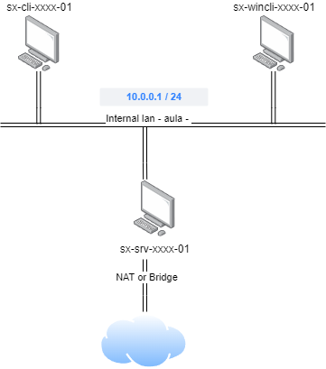

# 📎 AF.3.2.1 — Configuració i ús d'un servidor SSH Linux

## Objectiu

L'objectiu de la pràctica és configurar el següent escenari al servidor SSH, amb VirtualBox:

<figure><figcaption></figcaption></figure>

### Requisits:

Hem de configurar 3 màquines virtuals:

* 1 client amb LUbuntu o similar
* 1 client amb Windows 10
* 1 servidor amb Ubuntu Server 24.04

Les tres màquines virtuals client estaran connectades a la xarxa interna 'aula', amb IP estàtica.

Hem de configurar almenys, les següents directives al servidor SSH:

* El servidor SSH escoltarà les peticions al port 443.
* No hem de permetre les connexions SSH amb l'usuari root.
* Crearem al servidor dos usuaris (farem servir cada un dels nostres cognoms com a nom d'un usuari al servidor), i soles podrem connectar al servidor en aquests usuaris creats.
* Soles disposarem de 15 segons per a iniciar sessió al servidor, una volta connectats.
* Soles disposarem de 3 intents per a iniciar sessió al servidor, una volta connectats.
* Soles podrem connectar amb 1 usuari simultàniament al servidor.
* Deshabilitarem les connexions des del servidor Windows.

Una volta configurat el nostre servei ssh, mostrarem com fer les següents operacions:

* Copiar un fitxer local al servidor remot, fent servir scp
* Muntar un directori remot al sistema de fitxers local, crear un fitxer al directori local, i desmuntar el directori remot.
* Mostrar els dos fitxers creats al sistema de fitxers remot, executant l'ordre ls sense obrir una sessió remota.
* Crear un parell de claus RSA, i copiar la clau pública al host remot, per fer-la servir com clau d'autenticació de l'usuari nomenat com el teu primer cognom, i provar que funciona l'autenticació de l'usuari amb el parell de claus creades (SSH no haurà de demanar contrasenya d'usuari per a iniciar sessió).

### Format de l'entrega

* Gravar un vídeo d'entre 5 i 10 minuts, explicant la configuració aplicada, i mostrant el funcionament.

El vídeo haurà d'incloure:

* L'explicació detallada de totes les accions realitzades per poder configurar l'escenari, justificant-les.
* Mostrar els fitxers de la configuració de la xarxa, així com els comandaments emprats per aplicar la configuració, i per a provar el correcte funcionament.
* L'explicació detallada de totes les accions realitzades per poder configurar el servidor OpenSSH, justificant-les.
* Demostrar que els clients poden connectar amb un client SSH, seguint les especificacions donades.
