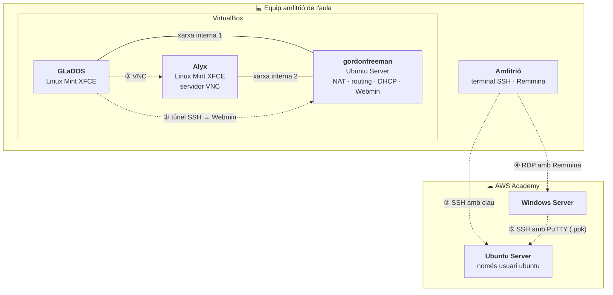

# AA-Q.3.2.1 — Administració remota segura i evidències de funcionament

> **Activitat d’aula qualificable única de SA03**
>
> **Tècnica d’avaluació:** activitat d’aula\
> **Instrument de qualificació:** rúbrica individual\
> **Resultat d’aprenentatge:** RA6 — Gestiona mètodes d’accés remot descrivint les seues característiques i instal·lant els servicis corresponents.

## Escenari

| Màquina           | Sistema i rol                                                        |
| ----------------- | -------------------------------------------------------------------- |
| **Amfitrió**      | Equip físic de l’aula on s’executa VirtualBox. **Des d’ell es connecta a AWS** (SSH i RDP amb Remmina). |
| **gordonfreeman** | Ubuntu Server. Encaminador NAT (routing + masquerade) i servidor DHCP de les dues xarxes internes. Hi instal·larem Webmin. |
| **GLaDOS**        | Linux Mint XFCE connectat a la **xarxa interna 1**. Client gràfic.   |
| **Alyx**          | Linux Mint XFCE connectat a la **xarxa interna 2**. Client gràfic i servidor VNC. |
| **Ubuntu Server (AWS)** | Instància EC2 a AWS Academy. Només accepta SSH amb clau i només per a l’usuari `ubuntu`. |
| **Windows Server (AWS)** | Instància EC2 a AWS Academy. Hi accedim per RDP i des d’ella administrem l’Ubuntu Server. |

## Condicions

* El treball és **individual**. Cada evidència ha de mostrar el teu nom d’usuari, el nom de la màquina o un identificador propi.
* **No lliures mai** contrasenyes, claus privades (`.pem`, `.ppk`), la contrasenya desxifrada de Windows ni captures que les mostren. Tapa-les si apareixen.
* En les instàncies d’AWS, la IP pública canvia cada vegada que arranques el laboratori: indica la que uses en cada evidència.

## E01 — Taula de màquines i connexions

Abans de començar, completa una taula amb les **IP reals** de les teues màquines (les de les xarxes internes les assigna el DHCP de gordonfreeman) i una altra amb els fluxos de l’activitat:

| Origen   | Destinació               | Protocol / port | Finalitat                           |
| ------- | ------------------------- | --------------- | ----------------------------------- |
| GLaDOS  | gordonfreeman             | SSH 22 → túnel 10000 | Administrar gordonfreeman amb Webmin |
| GLaDOS  | Alyx                      | VNC 5900        | Escriptori remot Linux → Linux      |
| Amfitrió | Ubuntu Server (AWS)      | SSH 22          | Administració i enduriment d’SSH    |
| Amfitrió | Windows Server (AWS)     | RDP 3389        | Escriptori remot Linux → Windows    |
| Windows Server (AWS) | Ubuntu Server (AWS) | SSH 22   | Administració Windows → Linux       |

## Part 1 — Webmin a gordonfreeman a través d’un túnel SSH

Repeteix a la teua infraestructura el que hem fet a classe amb la instància d’AWS, seguint l’activitat [AF.3.1.12 — Administració d’SSH amb Webmin a través d’un túnel SSH](../pindoles-formatives/af.3.1.12-administracio-dssh-amb-webmin-a-traves-dun-tunel-ssh.md).

1. Instal·la **Webmin** a gordonfreeman i comprova que escolta al port 10000.
2. Des de **GLaDOS** ja tens la clau pública autoritzada a gordonfreeman. Crea un **túnel SSH local** que redirigisca un port de GLaDOS cap al port 10000 de gordonfreeman.
3. Obri Webmin des del navegador de GLaDOS **a través del túnel** i inicia sessió.


Pensa amb quin usuari has d’entrar a Webmin. No tots els usuaris de gordonfreeman hi tenen accés: per què funciona el que has triat?


### Evidències

* **E02 — Webmin instal·lat:** a gordonfreeman, `systemctl status webmin` actiu i `sudo ss -tlnp | grep 10000`.
* **E03 — Túnel i accés:** a GLaDOS, l’ordre `ssh -L ...` que has usat i el navegador amb Webmin obert a `https://localhost:<port>`, on es veja el nom de màquina gordonfreeman.
* **E04 — Usuari de Webmin:** amb quin usuari has entrat i **per què** eixe usuari pot administrar el sistema des de Webmin.

## Part 2 — Seguretat SSH a la instància Ubuntu d’AWS

A classe hem deixat la instància Ubuntu d’AWS amb **autenticació només per clau** i amb accés SSH **només per a l’usuari `ubuntu`**. Ara has de revisar-ho a la teua instància i documentar-ho. Totes les connexions es fan **des de l’equip amfitrió**.

1. Localitza on es defineix `PasswordAuthentication` (recorda que a Ubuntu els fitxers de `/etc/ssh/sshd_config.d/` tenen prioritat sobre `sshd_config`) i comprova que val `no`.
2. Fes que **només l’usuari `ubuntu`** puga connectar per SSH (`AllowUsers`). Pots fer-ho des de Webmin (*SSH Server → Access Control*) o editant la configuració.
3. Valida la sintaxi amb `sudo sshd -t` i aplica els canvis. **Mantín oberta una sessió SSH** mentre proves des d’un altre terminal, per no quedar-te fora.
4. Comprova que:
   * `ubuntu` entra amb la clau;
   * l’accés amb contrasenya es rebutja: `ssh -o PubkeyAuthentication=no -o PreferredAuthentications=password ubuntu@<IP>`;
   * un altre usuari (per exemple `prova`, amb la mateixa clau autoritzada) es rebutja.

### Evidències

* **E05 — Configuració efectiva:** `grep -r . /etc/ssh/sshd_config.d/` i `sudo sshd -T | grep -Ei 'passwordauthentication|pubkeyauthentication|allowusers'`, amb els valors `passwordauthentication no`, `pubkeyauthentication yes` i `allowusers ubuntu`.
* **E06 — Proves:** connexió correcta d’`ubuntu`, intent per contrasenya rebutjat i intent de l’altre usuari rebutjat, amb les línies corresponents de `sudo journalctl -u ssh`.
* **E07 — Passos documentats:** llista breu, amb les teues paraules, dels passos que has seguit i en quin fitxer o opció de Webmin has fet cada canvi.

## Part 3 — VNC entre GLaDOS i Alyx

1. A **Alyx**, instal·la i configura un servidor VNC seguint el vídeo [Easy Remote Desktop with VNC on Linux Mint](https://www.youtube.com/watch?v=ktF6H3pq33I). Protegix-lo amb contrasenya.
2. Des de **GLaDOS**, connecta a l’escriptori d’Alyx per VNC.


GLaDOS i Alyx **no estan en la mateixa xarxa**. Quina IP has d’usar per arribar a Alyx i per on passen els paquets?


3. Dins de la sessió VNC, crea a l’escriptori d’Alyx el fitxer `vnc-<cognom>.txt` amb el text `Creat des de GLaDOS per VNC`.
4. A la consola local d’Alyx, comprova que el fitxer existeix i mostra’n el contingut.

### Evidències

* **E08 — Servidor VNC:** a Alyx, la IP (`ip -br a`) i el servidor VNC escoltant (`ss -tlnp`).
* **E09 — GLaDOS → Alyx:** client VNC de GLaDOS mostrant l’escriptori d’Alyx amb el fitxer creat, i la verificació local a Alyx.
* **E10 — Camí dels paquets:** `traceroute` (o `tracepath`) de GLaDOS a Alyx i una explicació breu del paper de gordonfreeman.

## Part 4 — Windows Server d’AWS amb Remmina

Ja vas desplegar una instància Windows Server a AWS (píndola **UDXX-04** de l’apartat AWS Academy). Ara hi connectaràs **des de l’equip amfitrió**.

1. A la consola d’EC2, selecciona la instància → **Connectar** → **Client RDP**: descarrega el fitxer d’escriptori remot i, amb **Obtindre la contrasenya**, desxifra la contrasenya d’`Administrator` pujant la clau `.pem`.
2. Connecta des de l’amfitrió amb **Remmina** (protocol RDP).
3. Al perfil de Remmina, configura i prova:
   * un **directori compartit** de l’amfitrió, perquè aparega a Windows;
   * la **resolució** de pantalla;
   * la **profunditat de color**;
   * el **tipus de connexió** (ample de banda disponible).
4. Copia un fitxer del directori compartit a l’escriptori de Windows.

### Evidències

* **E11 — Preparació:** pantalla de desxifrat de la contrasenya (**amb la contrasenya tapada**) i configuració del perfil de Remmina amb el directori compartit, la resolució, la profunditat de color i el tipus de connexió.
* **E12 — Sessió RDP:** Windows Server dins de Remmina, amb el directori compartit visible a l’Explorador i el fitxer copiat a l’escriptori.
* **E13 — Rendiment:** quins valors de resolució, color i tipus de connexió t’han anat millor amb la connexió de l’institut, i per què.

## Part 5 — De Windows Server a Ubuntu Server (AWS) amb PuTTY

Ara administraràs la instància Ubuntu **des de la instància Windows**, totes dues dins d’AWS.

1. A AWS Academy, descarrega la clau en format **PPK** (*AWS Details → Download PPK*) i passa-la a Windows Server. Pots fer servir el directori compartit de Remmina.
2. Instal·la [PuTTY](https://www.chiark.greenend.org.uk/~sgtatham/putty/latest.html) a Windows Server.
3. Configura PuTTY: host `ubuntu@<IP>` i, a *Connection → SSH → Auth → Credentials*, la clau `.ppk`. Guarda la sessió.
4. Connecta i executa `hostname` i `who`.


Les dues instàncies estan en la mateixa VPC d’AWS. Pots usar la IP pública o la **privada** de l’Ubuntu Server: quina és més adequada i què ha de permetre el grup de seguretat en cada cas?



En acabar, esborra el fitxer `.ppk` de Windows Server.


### Evidències

* **E14 — PuTTY configurat:** sessió guardada amb el host i la ruta de la clau `.ppk` (sense mostrar-ne el contingut).
* **E15 — Windows → Linux:** sessió de PuTTY oberta a l’Ubuntu Server amb `hostname` i `who`, on es veja l’IP d’origen (la de Windows Server). Indica si has usat la IP pública o la privada i per què.

## E16 — Comparativa i incidència resolta

Inclou una taula breu, escrita amb les teues paraules, comparant **SSH, VNC i RDP**: xifratge, autenticació, port, ús adequat, un avantatge i una limitació de cadascun. Explica també una incidència real que hages tingut i com l’has resolta.

## Rúbrica RA6

| Criteri                                                           | Per obtindre la puntuació màxima                                                                 | Punts |
| ----------------------------------------------------------------- | ------------------------------------------------------------------------------------------------ | ----- |
| **a)** Mètodes d’accés i administració remota                     | E16 compara SSH, VNC i RDP de manera correcta i raonada.                                         | 1     |
| **b)** Servei d’accés remot en línia de comandos                  | E02–E07: túnel SSH a gordonfreeman i SSH d’AWS (des de l’amfitrió) amb només clau i només `ubuntu`. | 2     |
| **c)** Servei d’accés remot en mode gràfic                        | E08–E13: VNC GLaDOS → Alyx i RDP amfitrió → Windows Server amb Remmina configurat.               | 2     |
| **d)** Comprovació dels mètodes                                   | E06, E09, E12 i E15 inclouen connexió, acció i verificació final pròpies.                        | 1,5   |
| **e)** Avantatges i deficiències                                  | E13 i E16 identifiquen usos, avantatges, limitacions i ajustos de rendiment.                     | 1     |
| **f)** Accés entre sistemes de diferent naturalesa                | E12 demostra Linux → Windows (RDP) i E15 Windows → Linux (SSH).                                  | 1     |
| **g)** Administració remota entre sistemes de diferent naturalesa | E03–E04 (Webmin pel túnel) i E15 (PuTTY) demostren administració remota i la justifiquen.        | 1     |
| **Seguretat, documentació i autonomia**                           | E01–E16 identificades, ordenades, individuals i sense credencials exposades.                     | 0,5   |

**Total: 10 punts.** Una evidència que no indique clarament número, origen, destinació i resultat no es considera vàlida fins que es complete.

## Lliurament

Entrega un únic **dossier PDF individual** amb les evidències **E01 a E16 en este ordre**. Cada evidència ha d’incloure una captura, el seu número, què demostra, màquina d’origen i màquina de destinació. No s’accepten vídeos com a lliurament.
